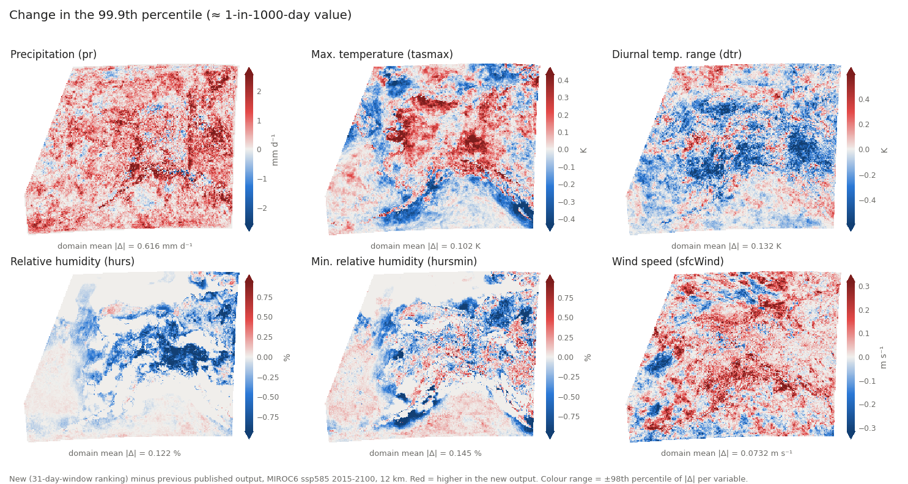
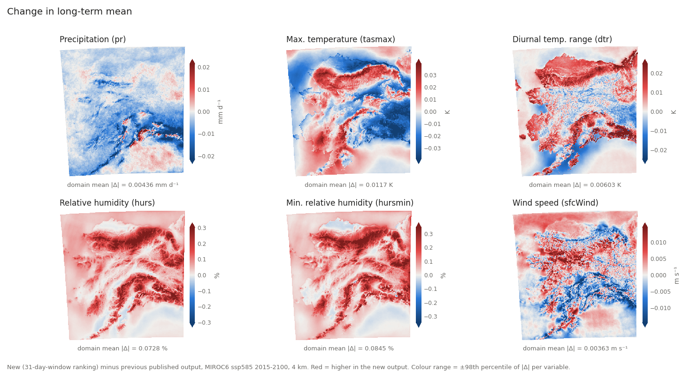
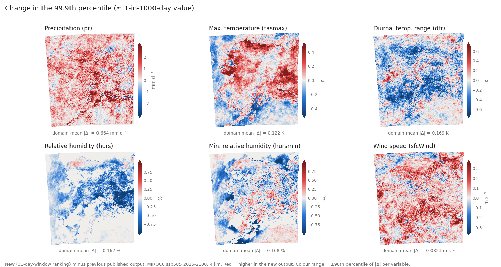

# patch_31d: QDM 31-day-window ranking fix

This is the single reference for the patch_31d work: what was wrong, what changed, how it was
tested, the 12 km and 4 km results, and (in the [Appendix](#appendix-technical-reference)) the
technical details needed to run or modify the code.

**Issue:** [#125](https://github.com/ua-snap/cmip6-utils/issues/125) · **Branch:** `patch_31d` (production code `193086a`) ·
**Status (2026-11-18):** 12 km and 4 km complete and verified (674 outputs); QC reports produced for every output

## 1. The problem

Quantile delta mapping (QDM) is trained per day-of-year using a **31-day moving window**
(±15 days, ~2,666 values per day-of-year for a 2015–2100 projection). When the trained
adjustment is applied, each simulated value is first ranked to find which quantile's
adjustment factor to use. In xclim 0.47.0 that ranking uses **only the exact day-of-year**
(`main_only=True`, ~86 values). Training and adjustment therefore used different
populations, so values were sometimes looked up at the wrong quantile. Training is
correct; only the ranking at adjustment time is affected. No argument of
`QuantileDeltaMapping.adjust()` controls this, so the fix replaces one xclim function at
runtime (Appendix A1).

**Scope of the re-run:** bias adjustment only (no re-training, no re-regridding), for all
non-snow variables: `pr`, `tasmax`, `dtr` (+ derived `tasmin`), `hurs`, `hursmin`,
`sfcWind`, at 12 km and 4 km.

## 2. What changed in the code

| Change | Why |
|---|---|
| **Windowed ranking.** At runtime, `qdm_window_patch.py` replaces xclim's `qdm_adjust` with an identical copy that ranks over the 31-day training window. The installed xclim is not modified. | Makes adjustment consistent with training. `--rank_main_only true` restores the old behaviour exactly. |
| **Untrained grid cells stay NaN.** | A fix merged in June (#112) filled every QDM NaN with the raw model value, which also put *unadjusted* GCM values into cells with no training data (3,439 cells at 12 km). |
| **Compute once, then write.** The adjustment is computed in one pass, then post-processed (squeezed) in memory. The proven synchronous write → rename → read-back path is kept. | The old code silently recomputed the entire adjustment 3× for `pr` and ~6× for `dtr`. |
| **Standard output layout:** `(time, y, x)`, float32, chunks `(365, 100, 100)`. | The previous products mixed dimension orders, chunkings and dtypes. |
| `hurs`/`hursmin` clipped to [0, 100] inside the adjustment step. | One less post-processing step. |
| Provenance attributes on every output: ranking mode, window, code version, input paths, squeeze counts. | Every file says how it was made. |
| Measured Dask/Slurm settings in `config.py` (spatial chunk 15; 12 km 4×4 workers on 120 GB; 4 km 6×4 on 500 GB). | Windowed ranking needs ~60× more memory per block, so chunks had to shrink. |
| `derived/difference.py` (tasmin = tasmax − dtr) updated for the new layout. | It would have failed on the new chunking and attributes. |
| New QC tools: `check_adjusted_complete.py`, `compare_rank_modes.py`, `summarize_runs.py`. | Used for the tests below and for every production output. |
| **QC reports as PDFs** (`downscaling/qc_report/`): replaces the production QC notebooks, and adds a new-vs-published comparison at the front of each report. | The notebooks took hours per model and needed converting to PDF by hand for collaborators. The new tool reads each store once (minutes per model) and writes the PDFs directly. |

## 3. Tests before production

| Test | Why | Result |
|---|---|---|
| **T0 Pixel proof:** hand-computed ranks vs xclim's internal ranks. | Confirm the bug exists and that the patch does what we claim. | ✅ Exact match in both modes (`pr`, `tasmax`). Example: one SSP day ranks at 0.388 against its 86 same-day values, but 0.414 against the 2,666 window values. |
| **T1 Regression:** new code in legacy mode vs existing outputs. | Prove the code refactor changes nothing except the ranking. | ✅ Bit-identical for `pr`, `tasmax`, `dtr`, `hurs`. |
| **T2 Tuning + invariance:** chunk sizes and worker layouts. | Find settings that fit in memory, and make sure the result doesn't depend on them. | ✅ Outputs bit-identical across chunk sizes 10/15/20 and three worker layouts. |
| **T3 Completeness:** every chunk written; NaN mask equals the expected mask. | Guard against the partial writes seen on beegfs in earlier runs. | ✅ All test outputs written after the untrained-cell fix are complete. |
| **T4 Science check:** windowed vs legacy statistics. | Size the effect of the fix. | ✅ Small in the bulk of the distribution, larger in the tails (Section 4). |
| **T5 4 km determinism:** the same 4 km job run 3× concurrently on different nodes. | 4 km runs were previously flaky. | ✅ All three runs bit-identical, with no worker restarts. |
| **T6 4 km original-variable inputs:** find which of the first run's many store versions was published, then re-run in legacy mode on its inputs. | The 4 km `pr`/`tasmax`/`dtr` inputs live in the first 4 km run's directories, alongside several experimental variants. | ✅ All 206 published stores are byte copies of one source per model. Legacy re-runs match the published `pr` and `tasmax` exactly. `dtr` differs in ~1,400 of 3.7 billion values (≤ 0.0013 K); see Section 5. |
| **T7 Partition invariance:** one 4 km job run on a 250 GB t2small node vs the analysis node. | Part of the 4 km run was moved to t2small to finish in ~10 h instead of ~30 h. | ✅ Bit-identical (6.4 billion values). |

## 4. 12 km results

**All 288 bias-adjusted outputs plus 50 derived `tasmin` outputs were produced and passed QC:**
- ✅ Every chunk is present.
- ✅ Each NaN mask equals the expected mask.
- ✅ Values are within the squeeze limits.
- ✅ `tasmin` equals `max(tasmax − dtr, 203.15 K)` exactly.

The run took about 65 node-hours, and no adjustment job failed. The job set exactly
matches the previous 12 km product (pr 56, tasmax 50, dtr 50, hurs 56, hursmin 27,
sfcWind 49). The 49 `sfcWind` stores include historical-only `sfcWind` for CNRM-CM6-1-HR and
EC-Earth3-Veg, which have no `sfcWind` scenarios; see the note in Section 5 and the table in
Appendix A7.

**NaN consistency:**
- Every output (338 new, and the 338 previous ones checked the same way) has the **same
  spatial NaN mask**: 11,641 cells, NaN on every day.
- The only exception is in the inputs: the regridded KACE-1-0-G `hursmin` historical and
  ssp585 inputs have extra NaN patches on 2 and 46 days. These are carried through
  unchanged, exactly as in the previous product. *Known source-data quirk; not fixed.*

**Size of the change (new − previous output; MIROC6 ssp585, 2015–2100):**

*In `hurs`/`hursmin`, the flat gray areas are cells where both versions sit at the 100 %
cap.*

Domain-average absolute change in each statistic:

| Variable (units) | Long-term mean | Median | 99th pct | 99.9th pct |
|---|---|---|---|---|
| pr (mm d⁻¹) | 0.005 | 0.004 | 0.17 | 0.62 |
| tasmax (K) | 0.010 | 0.044 | 0.047 | 0.10 |
| dtr (K) | 0.005 | 0.008 | 0.052 | 0.13 |
| hurs (%) | 0.065 | 0.063 | 0.081 | 0.12 |
| hursmin (%) | 0.085 | 0.094 | 0.14 | 0.15 |
| sfcWind (m s⁻¹) | 0.003 | 0.005 | 0.037 | 0.073 |

**Takeaway:**
- Changes to means and medians are small.
- Changes grow toward the tails: the upper tail for `pr`, `dtr` and `sfcWind`, and mostly the
  cold/dry (lower) tail for `tasmax`, `tasmin`, `hurs` and `hursmin`. The largest is in extreme
  precipitation, where the 1-in-1000-day value rises by 0.55 mm d⁻¹ on average and changes by
  between −9 and +13 mm d⁻¹ at individual cells.
- How often the QC thresholds are crossed (e.g. `pr` > 400 mm d⁻¹) changes by less than
  3 % for every variable.
- Downstream products that depend on extremes (indicators, climatologies of extremes)
  should be regenerated from the new outputs.

## 5. 4 km results

**All 336 outputs were produced and passed QC.** These are 286 bias-adjusted outputs plus 50
derived `tasmin`. The set of outputs matches the previous 4 km product exactly:

| Group | Outputs | Checks |
|---|---|---|
| New variables: `hurs` 56, `hursmin` 27, `sfcWind` 47 | 130 | ✅ Every chunk present; NaN mask = expected mask; within squeeze limits |
| Original variables: `pr` 56, `tasmax` 50, `dtr` 50 | 156 | ✅ Same checks |
| Derived `tasmin` | 50 | ✅ Equals `max(tasmax − dtr, 203.15 K)` exactly |

> **Note: 12 km and 4 km intentionally differ by two datasets** (338 vs 336 outputs; 79 vs 77
> QC reports). CNRM-CM6-1-HR and EC-Earth3-Veg have `sfcWind` for the historical period only,
> with no scenarios. Their historical `sfcWind` is included at 12 km and excluded at 4 km. Each
> resolution mirrors its previous published product (12 km: 49 `sfcWind` stores; 4 km: 47).
> Decision (2026-11-18): leave as is; do not add them at 4 km or remove them at 12 km.

**Run:**
- No adjustment job failed. The two waves used ~140 job-hours each.
- Part of the original-variable wave ran on 250 GB t2small nodes, which cut it from ~30 h to ~10.5 h.
  The results are bit-identical across node types (T7).

**Inputs for the original variables (T6):**
- The published 4 km `pr`/`tasmax`/`dtr`/`tasmin` came from the first 4 km run. Every published
  store was traced to a byte-identical source: `adjusted/` for `pr`/`tasmax`/`dtr`, and
  `cmip6_tasmin/` for `tasmin`.
- The re-run uses that run's trained datasets and regridded inputs. Re-running in legacy mode
  reproduces the published `pr` and `tasmax` exactly.

**One known, accepted difference.** The published 4 km `dtr` was made in February 2026 and set its
top/bottom clipping limits (0.00002 % of values) from exact quantiles. The current code, used
since April 2026 and for 12 km, uses a 10,000-bin histogram. In the store we tested, this moved
~1,400 of 3.7 billion values by at most 0.0013 K. We kept the histogram method so that both resolutions
match.

**NaN consistency:**
- Each group has a **single spatial NaN mask**, identical to the previous/published outputs for
  every store: 16,260 cells for the new variables, 15,381 for the original variables.
- As at 12 km, the only exception is the regridded KACE-1-0-G `hursmin` input, which has NaN
  patches on 2 historical and 41 ssp585 days. These are carried through unchanged. *Known
  source-data quirk; not fixed.*

**Size of the change (new − previous output; MIROC6 ssp585, 2015–2100):**

Domain-average absolute change in each statistic (4 km):

| Variable (units) | Long-term mean | Median | 99th pct | 99.9th pct |
|---|---|---|---|---|
| pr (mm d⁻¹) | 0.004 | 0.006 | 0.18 | 0.66 |
| tasmax (K) | 0.012 | 0.056 | 0.052 | 0.12 |
| dtr (K) | 0.006 | 0.010 | 0.060 | 0.17 |
| hurs (%) | 0.073 | 0.070 | 0.091 | 0.16 |
| hursmin (%) | 0.085 | 0.095 | 0.16 | 0.17 |
| sfcWind (m s⁻¹) | 0.004 | 0.006 | 0.040 | 0.082 |

**Takeaway:** the 4 km results look like the 12 km results.
- Means and medians barely change; changes are larger in the tails.
- The 1-in-1000-day precipitation value rises by 0.57 mm d⁻¹ on average and ranges from −11 to
  +21 mm d⁻¹ at individual cells.
- Threshold-exceedance counts stay within ~2 % of the published product (12 km: within ~3 %).

## 6. QC reports

Every output at both resolutions has been through the new PDF QC. Each variable × model report
leads with the new-vs-published comparison, followed by the checks from the production notebooks.

| Resolution | Reports | Summary |
|---|---|---|
| 12 km | 79 | `qc_summary_12km.pdf` |
| 4 km | 77 | `qc_summary_4km.pdf` |

The summary PDFs list the comparison metrics and threshold counts for every model and scenario,
with a page defining each column. Location:
`/import/beegfs/CMIP6/jdpaul3/cmip6_patch_31d_reruns/qc_reports/<res>/pdf/`.

## 7. Next steps

1. Review the QC reports, and hand the outputs to downstream QC (difference matrices).
2. Publish as a new version alongside the current product (no overwrite), then re-run
   climatologies and indicators.
3. PR `patch_31d → main`; close #125. Consider reporting the ranking behaviour upstream
   to xclim.
4. Port the same fix to the standalone `cmip6-downscaling` repo, **only after the full review of
   the patched dataset is complete.** The patch is `qdm_window_patch.py` plus how
   `bias_adjust.py` applies it (Appendix A1). Re-check the xclim version and ranking-line guard
   there before applying it.

## Appendix: technical reference

### A1. How the patch works

- **Where.** QDM is trained with `group="time.dayofyear", window=31` (`train_qm.py`). In xclim
  0.47.0, `xclim/sdba/_adjustment.py::qdm_adjust` ranks `sim` with `main_only=True`. The
  ranking therefore uses ~50–86 values (the same calendar day across all years) instead of
  the ~1,550–2,666 the factors were built from. The successor library xsdba exposes the
  consistent behaviour as `rank_window=True`.
- **What.** `bias_adjust/qdm_window_patch.py` re-defines `qdm_adjust` with the same
  `@map_blocks` decorator and the same code, except that `main_only` is configurable. It then
  rebinds `xclim.sdba.adjustment.qdm_adjust`, the name `QuantileDeltaMapping._adjust` looks
  up. The conda environment is not modified.
- **Safety.** The patch refuses to run unless xclim is 0.47.0 (pinned in `environment.yml`)
  and the expected ranking line is present in the installed source.
- **Switches.**
  - `config.QDM_RANK_WINDOWED = True` is the default; `False` gives the legacy behaviour.
  - `bias_adjust.py --rank_main_only true|false` overrides the config for A/B tests.
- **Training is unchanged**, so the existing `trained_datasets/` are reused.

### A2. Provenance attributes on every output

- **Global attrs:**
  - ranking mode: `qdm_rank_main_only`, `qdm_rank_window_days`, `qdm_nquantiles`;
  - code: `xclim_version`, `cmip6_utils_commit`, `bias_adjust_version`, `bias_adjust_run_label`;
  - inputs: `sim_path`, `trained_qdm_path`;
  - untrained cells: `n_cells_without_trained_qdm`;
  - squeeze: `squeeze_*` counts and limits.
- **Derived `tasmin`** also records `minuend_store`, `subtrahend_store`,
  `squeeze_lower_limit` and `squeeze_count_below`.

### A3. `bias_adjust.py` implementation notes

- **Chunking.** Adjustment chunks are `time=-1` with a spatial edge of
  `config.ADJUST_CHUNK_SIZE` (15 at both resolutions). The resolution is inferred from the
  grid shape, and the trained store is rechunked to match. Windowed ranking needs ~60× more
  memory per block than exact-day ranking (~2.8 GB for a 15×15 SSP block). Outputs are
  bit-identical across chunk sizes and worker layouts (T2, T7).
- **Memory.** `config.DASK_ADJUST` sets workers × threads per resolution. The memory limit
  per worker comes from `SLURM_MEM_PER_NODE` minus a client reserve of
  max(16 GB, 2 × the float32 result). Overrides: `--n_workers`, `--threads_per_worker`,
  `--memory_limit`, `--chunk_size`.
- **Measured settings and wall times** (production, per job):

  | Resolution / node | Workers × threads, memory | Historical | SSP | Notes |
  |---|---|---|---|---|
  | 12 km, t2small | 4 × 4, 120 GB | ~9 min | ~14–17 min | ~100 jobs at once; `pr` SSP is memory-tight (some worker restarts, outputs valid) |
  | 4 km, analysis | 6 × 4, 500 GB | ~40–45 min | ~60–75 min | 2 jobs per node |
  | 4 km, t2small 250 GB nodes | 3 × 3, `--mem=240G` | ~35 min | ~55–62 min | `pr` SSP tight (6 of 37 had a worker restart, outputs valid) |

  Windowed 4 km runs do not fit on the 128 GB nodes. In legacy mode on 120 GB, `pr` and `dtr`
  also stalled, and only `tasmax` historical finished.
- **Untrained cells.** NaN = sim NaN or an untrained cell (trained `af` all-NaN). Other
  QDM-produced NaN are still filled from `sim`, as in #112.
- **Compute once.** The adjusted array is gathered to the client in a single distributed
  compute. The Dask cluster is then closed, and the squeeze runs in memory:
  - `dtr`: 10,000-bin histogram limits at the 0.0000002 / 0.9999998 quantiles;
  - `pr`, `tasmax`, `hurs`, `hursmin`: fixed limits in `SQUEEZE_LIMITS`.

  The write path is unchanged: synchronous `to_zarr` to `<store>.writing`, rename, then a
  read-back check.
- **Test helpers:** `--isel "y=a:b,x=c:d"` (spatial subset), `--run_label` and
  `--worker_dir_local`.
- **Run log.** Each job log ends with a `RUN_SUMMARY {json}` line: phase timings, cluster and
  worker peak memory, and chunk-file counts after write and rename.

### A4. Running it

`run_bias_adjust.py` writes one Slurm script per variable × model × scenario and submits them.
- Inputs and outputs: `--sim_dir`, `--train_dir`, `--output_dir`, `--slurm_dir`.
- Job set: `--models`, `--scenarios`, `--variables`.
- Resources: `--resolution`, `--partition`, `--time_limit`, `--cpus_per_task`, `--mem`.
- Other options: `--extra_args` (passed to `bias_adjust.py`), `--exclude`, `--skip_complete`
  and `--dry_run`.

`#SBATCH` headers use full option names and set `--cpus-per-task`, so shared partitions are
not oversubscribed. Submit from a writable directory, or use `sbatch --chdir=/tmp`, because
Dask creates `dask-worker-space` in the working directory.

### A5. Verification tools

- `compare_rank_modes.py`:
  - `pixel`: proves on a tiny subset that xclim's `sim_q` equals an independently computed
    rank. It checks the legacy population (same calendar day) and the windowed one (±15 days).
  - `summary`: maps and statistics of windowed vs legacy (or new vs previous) outputs: mean,
    quantiles, max and wet days.
  - `regress`: A vs B numerical identity.
- `check_adjusted_complete.py`:
  - checks that every chunk is present, plus the time coordinate and attributes;
  - checks that the NaN mask equals the expected mask (sim NaN ∪ untrained cells, using
    `--train_dirs`);
  - `--hash` hashes **decoded** chunk bytes for run-to-run comparison. Multithreaded Blosc
    can write identical data to differently ordered compressed files, so file checksums
    don't work.
- `summarize_runs.py`: collects the `RUN_SUMMARY` lines of a set of job logs into a CSV.

### A6. `derived/` (tasmin = tasmax − dtr)

- `difference.py`:
  - reads inputs in their native zarr chunks;
  - keeps the minuend's encoding through the 203.15 K tasmin floor;
  - merges global attributes by value, without per-store provenance;
  - records the provenance attributes in A2.
- `run_cmip6_difference.py` has full-name `#SBATCH` options plus `--cpus_per_task`, `--mem`,
  `--time_limit`, `--array_limit` and `--dry_run`. It uses node-local numba/matplotlib
  caches and returns the real exit status.

### A7. Job sets

Each resolution re-runs exactly the job set of its previous published product:

| Resolution | pr | tasmax | dtr | tasmin (derived) | hurs | hursmin | sfcWind | total |
|---|---|---|---|---|---|---|---|---|
| 12 km | 56 | 50 | 50 | 50 | 56 | 27 | 49 | 338 |
| 4 km | 56 | 50 | 50 | 50 | 56 | 27 | 47 | 336 |

The two `sfcWind` stores that differ are historical-only CNRM-CM6-1-HR and EC-Earth3-Veg (see
the note in Section 5). Do not "fix" the mismatch without a decision to change the published
job sets.

### A8. QC reports

The PDF QC tool is general-purpose and has its own usage documentation:
[`downscaling/qc_report/README.md`](../../downscaling/qc_report/README.md). All of its
settings are in `downscaling/qc_report/config.yaml`.

---
Figures: `python make_figures.py --figdata <review/figdata>` (12 km, from
`compare_rank_modes.py summary`) and `python make_figures.py --qcdata <qc_reports/4km/data>
--res_label "4 km" --suffix _4km` (4 km, from the QC statistics). Outputs:
`/import/beegfs/CMIP6/jdpaul3/cmip6_patch_31d_reruns/`.
