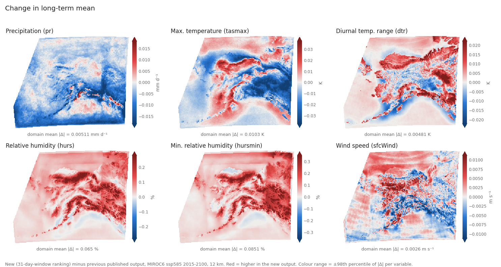

# patch_31d: QDM 31-day-window ranking fix — review summary

**Issue:** [#125](https://github.com/ua-snap/cmip6-utils/issues/125) · **Branch:** `patch_31d` (`193086a`) ·
**Status (2026-11-16):** 12 km complete and verified · 4 km new variables running · 4 km original variables waiting on inputs

## 1. The problem

Quantile delta mapping (QDM) is trained per day-of-year using a **31-day moving window**
(±15 days, ~2,666 values per day-of-year for a 2015–2100 projection). When the trained
adjustment is applied, each simulated value is first ranked to find which quantile's
adjustment factor to use. In xclim 0.47.0 that ranking uses **only the exact day-of-year**
(`main_only=True`, ~86 values). Training and adjustment therefore used different
populations, so values were sometimes looked up at the wrong quantile. Training is
correct; only the ranking at adjustment time is affected.

**Scope of the re-run:** bias adjustment only (no re-training, no re-regridding), for all
non-snow variables: `pr`, `tasmax`, `dtr` (+ derived `tasmin`), `hurs`, `hursmin`,
`sfcWind`, at 12 km and 4 km.

## 2. What changed in the code

| Change | Why |
|---|---|
| **Windowed ranking.** At runtime, `qdm_window_patch.py` replaces xclim's `qdm_adjust` with an identical copy that ranks over the 31-day training window. The installed xclim is not modified. | Makes adjustment consistent with training. `--rank_main_only true` restores the old behaviour exactly. |
| **Untrained grid cells stay NaN.** | A fix merged in June (#112) filled every QDM NaN with the raw model value, which also put *unadjusted* GCM values into cells with no training data (3,439 cells at 12 km). |
| **Compute once, then write.** The adjustment is computed in one pass, then post-processed (squeezed) in memory. The proven synchronous write → rename → read-back path is kept. | The old code silently recomputed the entire adjustment 3× for `pr` and ~6× for `dtr`. |
| **Standard output layout:** `(time, y, x)`, float32, chunks `(365, 100, 100)`. | The previous products mixed dimension orders, chunkings and dtypes. |
| `hurs`/`hursmin` clipped to [0, 100] inside the adjustment step. | One less post-processing step. |
| Provenance attributes on every output: ranking mode, window, code version, input paths, squeeze counts. | Every file says how it was made. |
| Measured Dask/Slurm settings in `config.py` (spatial chunk 15; 12 km 4×4 workers on 120 GB; 4 km 6×4 on 500 GB). | Windowed ranking needs ~60× more memory per block, so chunks had to shrink. |
| `derived/difference.py` (tasmin = tasmax − dtr) updated for the new layout. | It would have failed on the new chunking and attributes. |
| New QC tools: `check_adjusted_complete.py`, `compare_rank_modes.py`, `summarize_runs.py`. | Used for the tests below and for every production output. |

## 3. Tests before production

| Test | Why | Result |
|---|---|---|
| **T0 Pixel proof:** hand-computed ranks vs xclim's internal ranks. | Confirm the bug exists and that the patch does what we claim. | ✅ Exact match in both modes (`pr`, `tasmax`). Example: one SSP day ranks at 0.388 against its 86 same-day values, but 0.414 against the 2,666 window values. |
| **T1 Regression:** new code in legacy mode vs existing outputs. | Prove the code refactor changes nothing except the ranking. | ✅ Bit-identical for `pr`, `tasmax`, `dtr`, `hurs`. |
| **T2 Tuning + invariance:** chunk sizes and worker layouts. | Find settings that fit in memory, and make sure the result doesn't depend on them. | ✅ Outputs bit-identical across chunk sizes 10/15/20 and three worker layouts. |
| **T3 Completeness:** every chunk written; NaN mask equals the expected mask. | Guard against the partial writes seen on beegfs in earlier runs. | ✅ All test outputs written after the untrained-cell fix are complete. |
| **T4 Science check:** windowed vs legacy statistics. | Size the effect of the fix. | ✅ Small in the bulk of the distribution, larger in the tails (Section 4). |
| **T5 4 km determinism:** the same 4 km job run 3× concurrently on different nodes. | 4 km runs were previously flaky. | ✅ All three runs bit-identical, with no worker restarts. |

## 4. 12 km results

**All 288 bias-adjusted outputs plus 50 derived `tasmin` outputs were produced and passed QC:**
- ✅ Every chunk is present.
- ✅ Each NaN mask equals the expected mask.
- ✅ Values are within the squeeze limits.
- ✅ `tasmin` equals `max(tasmax − dtr, 203.15 K)` exactly.

The run took about 65 node-hours, and no adjustment job failed. The job set exactly
matches the previous 12 km product (pr 56, tasmax 50, dtr 50, hurs 56, hursmin 27,
sfcWind 49).

**NaN consistency:**
- Every output (338 new, and the 338 previous ones checked the same way) has the **same
  spatial NaN mask**: 11,641 cells, NaN on every day.
- The only exception is in the inputs: the regridded KACE-1-0-G `hursmin` historical and
  ssp585 inputs have extra NaN patches on 2 and 46 days. These are carried through
  unchanged, exactly as in the previous product. *Known source-data quirk; not fixed.*

**Size of the change (new − previous output; MIROC6 ssp585, 2015–2100):**

*In `hurs`/`hursmin`, the flat gray areas are cells where both versions sit at the 100 %
cap.*

Domain-average absolute change in each statistic:

| Variable (units) | Long-term mean | Median | 99th pct | 99.9th pct |
|---|---|---|---|---|
| pr (mm d⁻¹) | 0.005 | 0.004 | 0.17 | 0.62 |
| tasmax (K) | 0.010 | 0.044 | 0.047 | 0.10 |
| dtr (K) | 0.005 | 0.008 | 0.052 | 0.13 |
| hurs (%) | 0.065 | 0.063 | 0.081 | 0.12 |
| hursmin (%) | 0.085 | 0.094 | 0.14 | 0.15 |
| sfcWind (m s⁻¹) | 0.003 | 0.005 | 0.037 | 0.073 |

**Takeaway:**
- Changes to means and medians are small.
- Changes grow toward the tails, as expected: the largest is in extreme precipitation,
  where the 1-in-1000-day value rises by 0.55 mm d⁻¹ on average and changes by
  between −9 and +13 mm d⁻¹ at individual cells.
- Downstream products that depend on extremes (indicators, climatologies of extremes)
  should be regenerated from the new outputs.

## 5. 4 km — new variables (`hurs`, `hursmin`, `sfcWind`)

*Running; to be filled in.* 130 jobs on the analysis partition (the sfcWind
historical-only models CNRM-CM6-1-HR and EC-Earth3-Veg are excluded, as in the previous
product).

| Item | Result |
|---|---|
| Outputs produced / QC passed | _TBD_ / 130 |
| Node-hours | _TBD_ |
| NaN consistency | _TBD_ |
| Change vs previous (figures) | _TBD_ |

## 6. 4 km — original variables (`pr`, `tasmax`, `dtr` + `tasmin`)

*Waiting on input access; to be filled in.*

| Item | Result |
|---|---|
| Outputs produced / QC passed | _TBD_ |
| NaN consistency | _TBD_ |
| Change vs previous (figures) | _TBD_ |

## 7. Next steps

1. Finish the 4 km runs and fill in Sections 5–6.
2. Hand outputs to downstream QC (difference matrices, QC notebooks).
3. Publish as a new version alongside the current product (no overwrite), then re-run
   climatologies and indicators.
4. PR `patch_31d → main`; close #125. Consider reporting the ranking behaviour upstream
   to xclim.

---
Figures: `python make_figures.py --figdata <review/figdata>`. Comparison maps come
from `compare_rank_modes.py summary` (new vs previous outputs). Output location:
`/import/beegfs/CMIP6/jdpaul3/cmip6_patch_31d_reruns/`.
